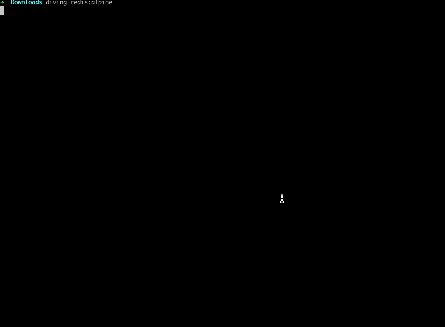
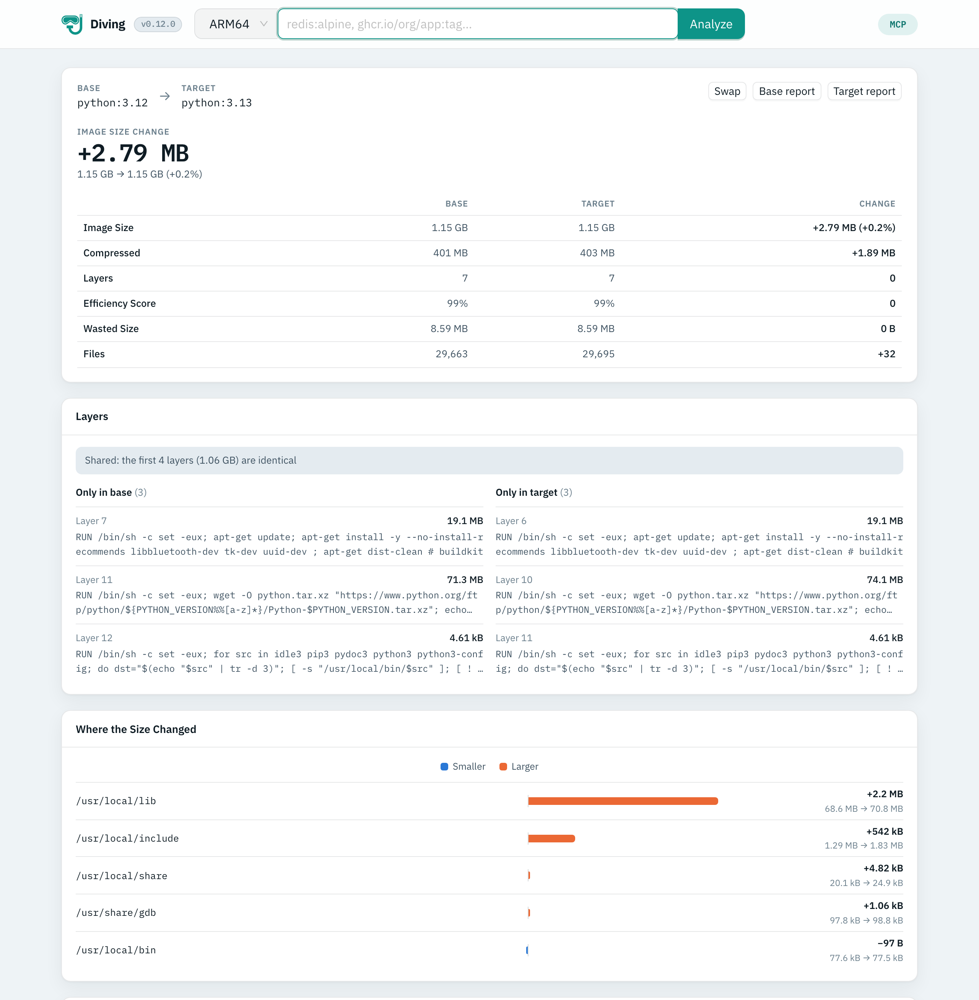
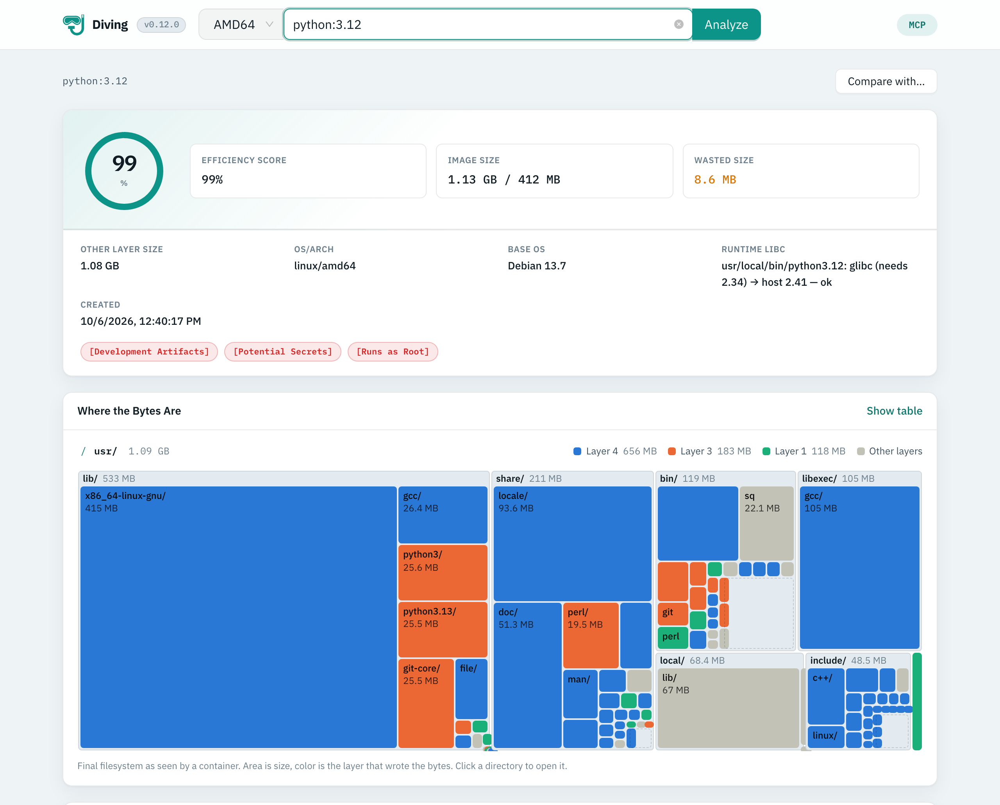

# diving-rs

[](https://github.com/vicanso/diving-rs/releases)
[](https://hub.docker.com/r/vicanso/diving)
[](./LICENSE)

[中文](./README-zh.md)

**Dive into every layer of a Docker image — find wasted space, leaked secrets, and bloat in seconds.**

A single, fast Rust binary that pulls images straight from any registry and shows you exactly what's inside. **No Docker daemon, no root, no dependencies.** Works on Linux, macOS and Windows.



## Why diving?

- ⚡ **Fast & standalone** — one static binary. Pulls layers directly from Docker Hub / any V2 registry, a local docker / podman client, a `docker save` tar or an OCI archive / layout. Layers are cached and downloads resume automatically.
- 🔍 **Layer-by-layer explorer** — an interactive TUI to walk the filesystem of every layer, with added / modified / removed files colorized.
- 📉 **Waste & bloat detection** — efficiency score, wasted bytes, cross-layer duplicate files, oversized layers, package-manager caches, dev/build artifacts, binaries shipped with debug info, and a reconstructed Dockerfile with anti-pattern linting.
- 🛡️ **Security hygiene checks** — flags leaked secret files (`.env`, SSH / cloud keys, certs), hardcoded credentials in `ENV`/labels/Dockerfile (key names only, never the value), setuid & world-writable files, and containers that run as root.
- 🤖 **AI optimization report** — hand the full analysis to any OpenAI-compatible model and get a prioritized fix list, plus version-over-version regression detection.
- 🔀 **Image diff** — compare two releases: what grew, which layers changed, which files were added, removed or resized.
- 🚦 **CI gate** — fail the pipeline when an image drops below your efficiency / wasted-bytes thresholds, outgrows a size cap, or grows too much since the last release. Ships as a GitHub Action with a job-summary report.
- 🌐 **Terminal · Web · MCP · JSON / Markdown · WeCom** — explore interactively, expose an HTTP API or an MCP endpoint for AI agents, export a report, or push results to a chat.

> **Scope note:** diving focuses on size, structure, and basic security checks (leaked secret files, file permissions, runs-as-root, etc.). It scans file **paths** and image metadata — it does **not** do CVE/vulnerability scanning or file-content scanning. Pair it with Trivy/grype/docker scout for vulnerability coverage.

## Quick start

```bash
# 1. install — pick one:
curl -fsSL https://raw.githubusercontent.com/vicanso/diving-rs/main/install.sh | sh   # prebuilt CLI binary
cargo install diving                                                                  # CLI / TUI from crates.io

# 2. dive in
diving redis:alpine
```

Three ways to use **diving**:

- **CLI / TUI / CI (`diving`)** — install via `install.sh`, `cargo install diving`, `cargo install --git https://github.com/vicanso/diving-rs diving`, or [prebuilt releases](https://github.com/vicanso/diving-rs/releases). No Docker daemon required.
- **Web Server / MCP / Webhook (`vicanso/diving` / `diving-web`)** — run via [Docker](#web-mode) or build `cargo build --release -p diving-web`.
- **Rust Library (`diving-core`)** — embed the analysis engine directly in another Rust service (see [Rust Library](#rust-library-diving-core)).

Inside the TUI:

| Key | Action |
|-----|--------|
| `1` | Show only `Modified` / `Removed` files of the current layer |
| `2` | Show only files ≥ 1 MB |
| `Esc` / `0` | Reset the view |

## Analyze any image

```bash
# from a registry (default) — Docker Hub, quay.io, private registries…
diving redis:alpine
diving quay.io/prometheus/node-exporter

# pick a platform of a multi-platform image (default: the host's;
# x86_64 / aarch64 are accepted for amd64 / arm64; arm/v6 vs arm/v7)
diving redis:alpine?arch=arm64
diving redis:alpine?arch=arm/v7

# pin an exact manifest by digest
diving redis@sha256:<digest>

# from the local docker or podman client (runs `docker save` / `podman save`)
diving docker://redis:alpine
diving podman://localhost/myapp:dev

# from a saved image: a `docker save` tar, an OCI archive tar
# (`podman save --format oci-archive`, buildx `--output type=oci`, skopeo `oci-archive:`)
# or an OCI layout directory
diving file:///tmp/redis.tar
diving file:///tmp/myapp-oci.tar

# a multi-platform OCI archive / layout: pick the platform
diving file:///tmp/myapp-layout?arch=arm64
```

## Export a report

```bash
# JSON — the full analysis plus efficiencyScore / wastedSize / wastedPercent
diving redis:alpine --output-file result.json

# Markdown (detected by the .md extension)
diving redis:alpine --output-file result.md

# Markdown to stdout — base image layers are auto-detected and hidden by default
diving myimage:latest --output-file -

# include the base image layers
diving myimage:latest --output-file - --no-skip-base

# a short Markdown summary — headline numbers, the largest files, the
# recommendations and, under CI=true, the gate verdict — sized for a
# pull-request comment or a CI job summary
diving myimage:latest --summary summary.md
```

## Compare two images

`diving diff <base> <target>` analyzes both images and shows what changed: the size change, the layers they share and the ones that differ, the directories where the size went, the largest added / removed / resized files, and the recommendations that appeared or were resolved.

```bash
# Markdown to stdout
diving diff myapp:1.4 myapp:1.5

# JSON (or Markdown, for a .md path) to a file
diving diff myapp:main myapp:pr-42 -o diff.json

# either side can be any source
diving diff myapp:latest docker://myapp:dev
```

Layers are matched by content (the image config's `diff_ids`), so a local build lines up with the published image it was built from. The two images are analyzed one after the other, so the layers they share are downloaded once.

In CI, set `highest_size_increase` to cap how much bigger (uncompressed) the target may be than the base; with `CI=true` diving exits `1` when it grew more. Without the option, `diff` only reports.

```bash
# .diving.yml: highest_size_increase: 50MB
CI=true diving diff -c .diving.yml myapp:main myapp:pr-42 --summary diff.md
```

The web UI compares too: **Compare with…** on a report, or `/?base=myapp:1.4&target=myapp:1.5`.



## CI gate

Run diving in CI to keep images lean. With `CI=true` it prints the efficiency score and **exits `1`** when any threshold is exceeded (see [exit codes](#exit-codes)).

```bash
CI=true diving redis:alpine
```

Thresholds are configurable in `~/.diving/config.yml`, or in a file you point to with `--config` — handy for keeping the gate next to the code:

```bash
CI=true diving --config .diving.yml myimage:latest
```

| Option | Default | Meaning |
|--------|---------|---------|
| `lowest_efficiency` | `0.95` | Minimum acceptable efficiency score (0–1) |
| `highest_wasted_bytes` | `20971520` (20 MB) | Maximum wasted bytes |
| `highest_user_wasted_percent` | `0.1` | Maximum wasted percentage (0–1) |
| `highest_image_size` | — (off) | Maximum uncompressed image size (the SIZE `docker images` shows), e.g. `500MB` |
| `fail_on_severity` | — (off) | Also fail when any recommendation is at this severity or above: `high`, `medium`, `low` or `info` |
| `highest_size_increase` | — (off) | [`diving diff`](#compare-two-images) only: maximum growth of the target over the base, e.g. `50MB` |

By default the recommendations (leaked secret files, runs-as-root, …) are only printed and do not affect the exit code. Set `fail_on_severity: high` to make findings such as a private key baked into the image fail the pipeline. `medium` and below also count heuristic suggestions (Dockerfile lint, docs/locale files, …), so expect more noise. A misspelled value stops diving at startup instead of silently disabling the check.

### Exit codes

| Code | Meaning |
|------|---------|
| `0` | Passed |
| `1` | The image failed the gate (a threshold above, or `fail_on_severity`) |
| `2` | diving itself failed: the image could not be pulled or analyzed, the config is invalid, an AI or WeCom call failed, … |

With `CI=true` the gate also applies when an [AI report](#ai-analysis) or [WeCom push](#wecom-push) is configured: diving sends the report first, then runs the checks.

`--summary <file>` writes a short Markdown report that opens with the verdict and the failed checks — post it as a pull-request comment or append it to the job summary.

### GitHub Action

The repository is also a GitHub Action: it installs the diving release binary, runs the gate and appends the summary to the job summary.

```yaml
- uses: vicanso/diving-rs@main
  with:
    image: ghcr.io/org/app:${{ github.sha }}
    config: .diving.yml          # gate thresholds (optional)
```

| Input | Default | Description |
|-------|---------|-------------|
| `image` | — | Image to analyze (any [source](#analyze-any-image)) |
| `base` | — | Compare `image` against this one instead (`diving diff`), e.g. the main-branch build; the gate is then `highest_size_increase` |
| `config` | — | Config file with the thresholds |
| `output` | — | Also write the full analysis here (`.json` or `.md`) |
| `summary-file` | temp file | Where to write the short summary |
| `job-summary` | `true` | Append the summary to the job summary |
| `version` | `latest` | diving release to install, e.g. `v0.12.0` |
| `args` | — | Extra arguments, e.g. `--lang zh` |

The step fails with diving's [exit code](#exit-codes). Its `summary-file` output is the summary's path, but GitHub passes no outputs on from a failed step — so to post the summary as a pull-request comment even when the gate fails, give the path yourself:

```yaml
- uses: vicanso/diving-rs@main
  with:
    image: ghcr.io/org/app:${{ github.sha }}
    summary-file: diving-summary.md
- if: always() && github.event_name == 'pull_request'
  run: gh pr comment ${{ github.event.number }} --body-file diving-summary.md
  env:
    GH_TOKEN: ${{ github.token }}   # needs `pull-requests: write`
```

### GitLab CI

GitLab sets `CI=true` in every job, so the gate is on. Install the standalone `diving` CLI binary (note: `vicanso/diving` runs the `diving-web` server, whereas CI jobs use the lightweight `diving` CLI):

```yaml
image-check:
  image: debian:bookworm-slim
  variables:
    # pull from the project's own registry
    REGISTRY_USERNAME: $CI_REGISTRY_USER
    REGISTRY_PASSWORD: $CI_REGISTRY_PASSWORD
  before_script:
    - apt-get update && apt-get install -y --no-install-recommends curl ca-certificates
    - curl -fsSL https://raw.githubusercontent.com/vicanso/diving-rs/main/install.sh | sh
  script:
    - diving "$CI_REGISTRY_IMAGE:$CI_COMMIT_SHORT_SHA" --summary diving-summary.md
  artifacts:
    when: always
    paths: [diving-summary.md]
```

To compare against the main-branch build, run `diving diff "$CI_REGISTRY_IMAGE:main" "$CI_REGISTRY_IMAGE:$CI_COMMIT_SHORT_SHA"` instead.

### Accepting known findings

Every recommendation has a stable id, printed in parentheses in the CI output and available as `id` in the JSON. List the findings you have reviewed and accept under `ignore_recommendations`. They are still printed, marked `ignored`, but no longer count toward `fail_on_severity` (the three thresholds above are unaffected):

```yaml
fail_on_severity: high
ignore_recommendations:
  - secfiles
```

| Id | Recommendation | Severity |
|----|----------------|----------|
| `secfiles` | Potential secrets in image | high |
| `secmeta` | Secrets in image metadata (ENV / labels / Dockerfile) | high |
| `worldread` | World-readable secret files | high |
| `runtimecompat` | Entrypoint binary incompatible with the base image's libc | high (medium for a musl binary on a glibc image) |
| `wasted` | Reclaim wasted space | medium (high above 10% wasted) |
| `crossdup` | Files duplicated across layers | low (medium from 5 MB, high from 50 MB) |
| `pkgcache` | Remove package manager cache | medium |
| `devart` | Exclude development artifacts | medium |
| `runasroot` | Container runs as root | medium |
| `setuid` | setuid/setgid binaries | medium |
| `worldwrite` | World-writable files | medium |
| `oversized` | Oversized layer(s) | low or medium |
| `dflint` | Dockerfile anti-patterns | low or medium |
| `layercount` | Reduce layer count | low |
| `junk` | Editor/OS junk files | low |
| `slimbase` | Consider a slimmer base image | low |
| `buildonly` | Build-only files in runtime image | low |
| `doclocale` | Documentation / man / locale data | low |
| `logtemp` | Log / temp files baked into image | low |
| `toolchain` | Build toolchain present in final image | low |
| `unstripped` | Binaries with debug info or symbol tables (`strip` would shrink them) | low (medium from 10 MB) |
| `bigfiles` | Large files added in recent layers | info |
| `netreclaim` | Net reclaimable estimate | info |

## AI analysis

Provide an OpenAI-compatible API key and diving sends the full Markdown analysis (layers, reconstructed Dockerfile, wasted space, large files, security findings) to the model and prints a prioritized optimization report instead of opening the TUI. When the `ENTRYPOINT`/`CMD` points to a script inside the image, that script is read from the layers and included, so the model can review what the container actually runs.

```bash
# enable AI analysis (prints the report, skips the TUI)
diving redis:alpine --ai-api-key sk-xxxx

# custom endpoint / model
diving redis:alpine \
  --ai-api-key sk-xxxx \
  --ai-base-url https://your-gateway/v1 \
  --ai-model gpt-4o

# configure via the environment
export OPENAI_API_KEY=sk-xxxx
diving redis:alpine

# control the report language (also affects terminal / Markdown output)
diving redis:alpine --ai-api-key sk-xxxx --lang zh
```

| Flag | Environment | Default | Description |
|------|-------------|---------|-------------|
| `--ai-api-key` | `OPENAI_API_KEY` | — | OpenAI-compatible API key. Providing it enables AI analysis. |
| `--ai-base-url` | `OPENAI_BASE_URL` | `https://api.openai.com/v1` | API base URL. A full `.../chat/completions` URL is also accepted. |
| `--ai-model` | `OPENAI_MODEL` | `gpt-4o` | Model name. |
| `--ai-system-prompt` | `OPENAI_SYSTEM_PROMPT` | built-in DevSecOps template | Override the system prompt to fully replace the built-in one. |
| `--lang` | `DIVING_LANG` | system locale | Output language: `en` or `zh`. |
| `--no-ai-history` | — | off | Skip the regression comparison for this run (the snapshot is still refreshed). |

Each run stores a snapshot under `~/.diving/ai_history/`. On the next run of the same image, the previous snapshot is sent alongside the current one so the model can flag size regressions / bloat between versions. `--no-ai-history` skips that comparison for one run (e.g. when the baseline is stale); the snapshot is still refreshed so subsequent runs compare against this one.

> Security tip: the API key, base URL and webhook are **CLI/env only** — they are never accepted as web query parameters, so they don't end up in access logs.

## Push notifications (WeCom · Feishu · DingTalk · Slack · Webhook)

Configure one or more outbound channels to push the analysis result straight to your team chat or downstream system instead of opening the TUI (or automatically after a [`POST /api/webhook`](#post-apiwebhook) trigger in web mode):

- with `--ai-api-key` (`$OPENAI_API_KEY`) set → pushes the concise AI optimization report
- without AI → pushes a short summary (efficiency score, wasted space, image size, recommendations)

When `public_url` (`--public-url` / `$DIVING_PUBLIC_URL`) is configured, messages include a clickable link to the web UI report (`/?image=…&arch=…`). Under `CI=true` (or when triggered by `/api/webhook`), messages also open with the [CI gate](#ci-gate) verdict so readers see passed/failed checks at a glance.

```bash
# WeCom (bare key expanded automatically, or pass the full webhook URL)
diving redis:alpine --wecom-webhook 693a91f6-7aoc-4bc4-97a0-0ec2sifa5aaa

# Feishu / Lark (bare hook ID expanded automatically; optional signing secret)
diving redis:alpine --feishu-webhook HOOK_ID --feishu-secret SECRET

# DingTalk (bare access_token expanded automatically; optional SEC... secret)
diving redis:alpine --dingtalk-webhook ACCESS_TOKEN --dingtalk-secret SEC...

# Slack
diving redis:alpine --slack-webhook "https://hooks.slack.com/services/T/B/X"

# Custom HTTP JSON webhook (optional HMAC-SHA256 signature in X-Diving-Signature)
diving redis:alpine --notify-webhook "https://hooks.example.com/diving" --notify-webhook-secret SECRET

# Push the AI report instead of the summary, and attach a clickable Web UI link
diving redis:alpine --ai-api-key sk-xxxx --feishu-webhook HOOK_ID --public-url https://diving.example.com
```

| Flag | Environment | Config key | Description |
|------|-------------|------------|-------------|
| `--wecom-webhook` | `WECOM_WEBHOOK` | `wecom_webhook` | WeCom group-bot webhook URL or bare bot key (~4096-byte markdown limit). |
| `--feishu-webhook` | `FEISHU_WEBHOOK` | `feishu_webhook` | Feishu custom bot webhook URL or bare hook ID (sends interactive card). |
| `--feishu-secret` | `FEISHU_SECRET` | `feishu_secret` | Optional Feishu signing secret. |
| `--dingtalk-webhook` | `DINGTALK_WEBHOOK` | `dingtalk_webhook` | DingTalk custom bot webhook URL or bare `access_token`. |
| `--dingtalk-secret` | `DINGTALK_SECRET` | `dingtalk_secret` | Optional DingTalk signing secret (`SEC…`). |
| `--slack-webhook` | `SLACK_WEBHOOK` | `slack_webhook` | Slack Incoming Webhook URL. |
| `--notify-webhook` | `NOTIFY_WEBHOOK` | `notify_webhook` | Generic HTTP endpoint receiving structured JSON (`event: "analysis.completed"`). |
| `--notify-webhook-secret` | `NOTIFY_WEBHOOK_SECRET` | `notify_webhook_secret` | Optional HMAC-SHA256 secret signing `X-Diving-Signature: sha256=<hex>`. |
| `--public-url` | `DIVING_PUBLIC_URL` | `public_url` | Public base URL of the web UI for clickable report links. |

Resolution priority: CLI flag → environment variable → `~/.diving/config.yml`. Oversized chat messages are truncated gracefully with `… (truncated)`.

## Web mode

Run diving as an HTTP server with a React frontend for remote analysis.

```bash
# Create the data directory and grant it to the container user (UID/GID 1000)
mkdir -p $PWD/diving
chown -R 1000:1000 $PWD/diving

docker run -d --restart=always \
  -p 7001:7001 \
  -v $PWD/diving:/home/rust/.diving \
  --name diving \
  vicanso/diving
```

Open `http://127.0.0.1:7001/` in the browser.



Besides the layer explorer and the findings, a report has a treemap of the final filesystem (area is size, color is the layer that wrote the bytes; click a directory to drill in), a preview for text files (binary ones show a hex dump), and **Compare with…** to [diff](#compare-two-images) the image against another one — or against another platform of the same image. The platform selector next to the search box lists the platforms the image is published for and switches between them. While a first analysis is still downloading the layers, the page shows the layer list from the manifest: each build step with its compressed size.

The container runs as a non-root UID (`1000:1000`); the `chown` above lets it write the layer cache (without it the container fails to start). The image is based on `debian:trixie-slim` plus a CA certificate bundle. It has no `tzdata`, so timestamps are in UTC, and it ships no `wget`/`curl`, so there is no in-image `HEALTHCHECK` — probe `GET /ping` from your orchestrator (Kubernetes `livenessProbe`, a sidecar, etc.) instead.

Change the listen address with `--listen` (the `diving-web` binary serves Web UI, HTTP API, MCP, and Webhook; it also accepts legacy `--mode web` for backward compatibility):

```bash
diving-web --listen 0.0.0.0:8080
```

### API

#### `GET /api/analyze`

Analyze a Docker image and return the result.

| Parameter | Type | Required | Description |
|-----------|------|----------|-------------|
| `image` | string | yes | Image reference (same formats as terminal mode) |
| `format` | string | no | `markdown` for the Markdown report instead of JSON, `summary` for the short summary (as `--summary`) |
| `skipBase` | bool | no | When `format=markdown`, auto-detect and hide base image layers (default `true`); set `false` to include them |

```bash
# JSON response (default)
curl "http://127.0.0.1:7001/api/analyze?image=redis:alpine"

# specify architecture
curl "http://127.0.0.1:7001/api/analyze?image=redis:alpine%3Farch%3Darm64"

# Markdown report
curl "http://127.0.0.1:7001/api/analyze?image=redis:alpine&format=markdown"

# Markdown report including base layers (hidden by default)
curl "http://127.0.0.1:7001/api/analyze?image=myimage:latest&format=markdown&skipBase=false"
```

#### `GET /api/manifest`

The layers of a registry image from its manifest and config alone — build steps, compressed sizes, platforms — without reading any layer (`image` as for `/api/analyze`). The web UI shows it while a first analysis runs.

#### `GET /api/diff`

Compare two images (see [Compare two images](#compare-two-images)).

| Parameter | Type | Required | Description |
|-----------|------|----------|-------------|
| `base` | string | yes | The image compared against |
| `target` | string | yes | The image checked |
| `format` | string | no | `markdown` for the Markdown diff instead of JSON |

```bash
curl "http://127.0.0.1:7001/api/diff?base=myapp:1.4&target=myapp:1.5"
```

#### `POST /api/webhook`

Receive a registry image push event, respond immediately with `202 Accepted`, invalidate in-memory caches for that tag, analyze the updated image in the background (respecting `registry_allowlist` and `max_concurrent_analyses`), and — when analysis succeeds — push the result to all configured [notification channels](#push-notifications-wecom--feishu--dingtalk--slack--webhook).

Supported payload formats (auto-detected):

- **Generic JSON**: `{"image": "org/app:v1"}` or `{"images": [...], "archs": ["amd64", "arm64"], "lang": "zh"}`
- **Harbor**: `PUSH_ARTIFACT` / `pushImage` (`event_data.resources[].resource_url`; other event types return `200 {"status":"ignored"}`)
- **Docker Hub / Aliyun ACR / Tencent TCR**: `push_data` + `repository` (automatically builds `registry.<region>.aliyuncs.com/...` when `repository.region` is present)
- **Docker Registry v2**: `events[]` with `action: "push"` and manifest/index media types (blob layer pushes and pulls are ignored)

Optional query parameters: `?token=<secret>` (for URL-only registries), `?registry=<host>` (override registry host), `?arch=arm64`, `?lang=zh`.

Security:

- Set `--webhook-token <token>` (`$DIVING_WEBHOOK_TOKEN` or `webhook_token` in `config.yml`). Accepted via `Authorization: Bearer <token>`, raw `Authorization: <token>`, `X-Webhook-Token`, `X-Gitlab-Token`, `X-Hub-Signature-256: sha256=<hmac>`, or `?token=<token>`.
- When no token is configured, `/api/webhook` only accepts loopback / RFC 1918 private peers (and rejects requests carrying public `X-Forwarded-For` hops) unless `webhook_allow_public: true` is set. `--no-webhook` disables the endpoint.

```bash
diving-web \
  --listen 0.0.0.0:7001 \
  --webhook-token "$DIVING_WEBHOOK_TOKEN" \
  --feishu-webhook "$FEISHU_WEBHOOK" \
  --public-url https://diving.example.com

curl -X POST "http://127.0.0.1:7001/api/webhook" \
  -H "Authorization: Bearer $DIVING_WEBHOOK_TOKEN" \
  -H "Content-Type: application/json" \
  -d '{"image":"ghcr.io/org/app:1.2.3"}'
```

### MCP

Web mode also serves an [MCP](https://modelcontextprotocol.io) endpoint at `/mcp` (Streamable HTTP transport), so AI agents such as Claude Code can analyze images themselves:

```bash
claude mcp add --transport http diving http://127.0.0.1:7001/mcp
```

The **MCP** button in the web UI's header shows the same setup, filled in with the address you are browsing: the endpoint, the Claude Code command and a JSON config for other clients, each with a copy button. It also warns when that address would be rejected by the `Host` check below.

| Tool | Returns |
|------|---------|
| `analyze_image` | The Markdown report (same as `format=markdown`) |
| `get_findings` | Findings as JSON: efficiency, wasted bytes, recommendations, sensitive files, duplicates, runtime compatibility, per-layer summary |
| `list_files` | A page of files, filterable by layer, directory, keyword and size |
| `read_file` | One text file from a layer (up to 256 KiB; registry images only) |
| `diff_images` | A Markdown diff of two images (same as `diving diff`) |
| `latest_images` | Recently analyzed images |

Layer numbers are 1-based and match the report. MCP calls share the analysis cache, request deduplication and `registry_allowlist` with `/api/analyze`. A cold analysis can take minutes; when the client sends a progress token, diving emits a progress notification every 10 seconds.

Access control:

- By default `/mcp` only accepts requests whose `Host` is loopback (`localhost`, `127.0.0.1`, `::1`), which blocks DNS-rebinding attacks from web pages. To serve remote clients, pick one:
  - Set a token with `--mcp-token <token>` (or `$DIVING_MCP_TOKEN`). Every request must then carry `Authorization: Bearer <token>`, and the `Host` check is skipped:
    ```bash
    claude mcp add --transport http diving https://diving.example.com/mcp \
      --header "Authorization: Bearer <token>"
    ```
  - Allow your hostnames in `~/.diving/config.yml` with `mcp_allowed_hosts: [diving.example.com]` (`"*"` turns the check off).
- `--no-mcp` turns the endpoint off.

The Docker image listens on `0.0.0.0`, so for remote MCP clients pass the token as an environment variable, e.g. `docker run -e DIVING_MCP_TOKEN=<token> …`. Clients on the same host can use `http://127.0.0.1:7001/mcp` without one.

## Sensitive-file scanning

During analysis diving scans every file **path** against built-in rules (`.env` files, SSH private keys, AWS/GCP credentials, TLS private keys, kubeconfig, `.htpasswd`, an accidentally-copied `.git` directory, …) and reports matches under **Security Warnings**. (It scans paths and metadata, not file contents.)

Extend or suppress the rules with `~/.diving/sensitive-files` — one rule per line:

| Line format | Effect |
|-------------|--------|
| `<glob-pattern>` | Flag matching files (reason: "Custom sensitive file") |
| `<glob-pattern> \| <reason>` | Flag with a custom reason label |
| `!<glob-pattern>` | Ignore / suppress matches (overrides built-in and custom patterns above) |

Lines starting with `#` and blank lines are ignored. Globs are case-insensitive; `*` matches across directory separators, and patterns are also tested against the filename alone (so `*.pem` matches `a/b/cert.pem`).

```
# ── Extra patterns ───────────────────────────────────────────
**/*.vault-token | Vault token
**/app-secrets.json | Application secrets

# ── Suppress built-in rules for intentional inclusions ───────
!**/.env.example
!**/.env.template
!**/certs/nginx.crt
!**/testdata/**
!**/fixtures/**
```

## Configuration

Config file: `~/.diving/config.yml`. Use `--config <file>` (`-c`) or `$DIVING_CONFIG` to read a different file; the flag wins over the environment variable. A file given this way must exist — diving exits with an error instead of falling back to defaults — and is parsed as YAML whatever its extension. Only the config file moves: `sensitive-files`, `ai_history/` and the default cache directories stay under `~/.diving/`.

| Option | Default | Description |
|--------|---------|-------------|
| `layer_path` | `~/.diving/layers` | Layer blob cache directory |
| `layer_ttl` | `90d` | TTL for cached layer blobs **and** analysis results; an entry is purged if not accessed within this duration |
| `analysis_path` | `~/.diving/analysis` | Analysis-result cache directory |
| `cleanup_interval_hours` | `1` | How often (hours) caches are swept for expired entries |
| `layer_concurrency` | `min(layers, 2 × CPUs)` | Concurrent layer fetch + decompression tasks per image. Raise on fast networks with many layers; lower when sharing the host |
| `worker_threads` | number of CPUs | Tokio runtime worker threads. Raise for a web server that handles many requests at once |
| `threads` | — | Legacy single knob: used for both of the two options above when they are not set |
| `lowest_efficiency` | `0.95` | CI check — minimum efficiency score (0–1) |
| `highest_wasted_bytes` | `20971520` | CI check — maximum wasted bytes (20 MB) |
| `highest_user_wasted_percent` | `0.1` | CI check — maximum wasted percentage (0–1) |
| `highest_image_size` | — | CI check — maximum uncompressed image size, e.g. `500MB`; unset = no limit |
| `highest_size_increase` | — | CI check for `diving diff` — maximum growth of the target over the base, e.g. `50MB`; unset = report only |
| `fail_on_severity` | — | CI check — fail when any recommendation is at this severity or above (`high` / `medium` / `low` / `info`); unset = recommendations never fail the run |
| `ignore_recommendations` | — | CI check — recommendation ids excluded from `fail_on_severity` (see [Accepting known findings](#accepting-known-findings)) |
| `registry_allowlist` | — | Web mode: when non-empty, `/api/analyze`, `/api/diff` and MCP only accept images from these registry hosts (e.g. `index.docker.io`, `ghcr.io`); add `local-file` / `local-docker` / `local-podman` to allow `file://` / `docker://` / `podman://` |
| `max_download_file_size` | `104857600` | Web mode: largest single file `/api/file` will serve (100 MB) |
| `analysis_memory_ttl` | `1m` | Web mode: how long a finished analysis is kept in memory. Requests for the same image within this window are answered without contacting the registry; the price is that a re-pushed tag can take this long to show up. `0s` turns it off |
| `max_concurrent_analyses` | — | Web mode: how many different images may be analyzed at once; further requests wait their turn. Unset = no limit |
| `max_layer_cache_size` | — | Total size cap for the layer cache; when exceeded, the least recently accessed blobs are evicted. Unset = TTL cleanup only |
| `mcp_allowed_hosts` | — | Web mode: extra `Host` values `/mcp` accepts besides loopback (`"*"` turns the check off; ignored when `--mcp-token` is set) |
| `public_url` | — | External base URL of the web UI for clickable links inside push notifications |
| `webhook_token` | — | Web mode: token/secret required on `POST /api/webhook` (overridden by `--webhook-token` / `$DIVING_WEBHOOK_TOKEN`) |
| `webhook_allow_public` | `false` | Web mode: allow unauthenticated `POST /api/webhook` from public IPs (unsafe unless isolated otherwise) |
| `wecom_webhook` / `feishu_webhook` / `feishu_secret` / `dingtalk_webhook` / `dingtalk_secret` / `slack_webhook` / `notify_webhook` / `notify_webhook_secret` | — | Outbound notification fallbacks when CLI flags and env vars are unset |

```yaml
layer_ttl: 30d
cleanup_interval_hours: 6
layer_concurrency: 4
lowest_efficiency: 0.95
highest_wasted_bytes: 20971520
highest_user_wasted_percent: 0.1
```

## How caching works

diving keeps two on-disk caches under `~/.diving/`, both governed by `layer_ttl` and swept hourly:

- **Layer blobs** (`~/.diving/layers/`) — compressed layer downloads, keyed by layer digest. A hit skips the network download; decompression and file-tree construction still run.
- **Analysis results** (`~/.diving/analysis/`) — the fully analyzed result, keyed by the `Docker-Content-Digest` (from a `HEAD` against the manifest endpoint), plus the architecture when that digest is a multi-platform index. An image published for a single platform is keyed by its digest alone, so requests for it with any `?arch=` share one entry, and a reference without `?arch=` shares the entry of `?arch=<host architecture>`. A hit short-circuits the entire pipeline.

The analysis cache is **content-addressable**, so re-pushing a mutable tag like `:latest` automatically invalidates the entry. If the `HEAD` probe fails for any reason, diving silently falls back to a full analysis — caching never blocks a request.

**When the registry is unavailable.** If the registry cannot be reached, is overloaded (5xx) or rate-limits the request (429), and the same image reference was analyzed before, diving shows that cached analysis instead of an error. The terminal UI, the Markdown report, the web UI, WeCom pushes and the JSON (`staleAsOf`) all say when it was made, because the tag may point at a different image by now. An error the registry itself returns (401, 403, 404) is never papered over this way, and neither is a CI run: with `CI=true` the gate has to judge the image as it is, so it fails with exit code `2`.

> Because layer data is downloaded from the source (e.g. Docker Hub), the first run on a large image can take a while. Interrupted downloads resume automatically. For privately-deployed registries, run diving (or its web image) on a host that can reach the registry.

## Rust Library (`diving-core`)

You can embed the pure Rust analysis engine directly in another Rust service without Axum, TUI, CLI, or `~/.diving` filesystem side effects:

```toml
[dependencies]
diving-core = "0.12.3"
```

```rust
use diving_core::{to_markdown, AnalyzeOptions, Analyzer, CacheConfig, Lang};

#[tokio::main]
async fn main() -> diving_core::Result<()> {
    let analyzer = Analyzer::builder()
        .cache(CacheConfig::ephemeral())
        .build()?;

    let result = analyzer
        .analyze("redis:alpine", AnalyzeOptions::default().lang(Lang::En))
        .await?;
    println!("{}", to_markdown(&result, true, Lang::En));
    Ok(())
}
```

By default, `Analyzer::builder()` uses an ephemeral temporary cache (cleaned up on drop), disables local sources (`file://`, `docker://`, `podman://`) and `~/.docker/config.json`, enables singleflight request deduplication, and can be locked down further with `.registry_allowlist(...)` and `.max_concurrent_analyses(...)`. See [crates/diving-core/README.md](./crates/diving-core/README.md) for the full library guide.

## License

Licensed under the [Apache License 2.0](./LICENSE).
